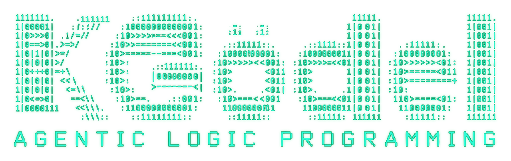

<p align="center">
  
</p>

# Introducing KGodel

**An experimental agentic logic language for reasoning, acting, and explaining decisions.**

KGodel is a programming language for exploring how software agents can work toward goals while keeping track of what they believe, what remains unknown, and what new evidence changes. Inspired by Prolog, it brings logical rules together with observations, actions, hypothetical questions, and plans that unfold over several steps.

Its central question is straightforward: **how can an agent make decisions whose supporting evidence we can inspect?**

## For non-developers: an agent that checks its assumptions

An agent is a software system that takes steps toward a goal. In KGodel, we give it beliefs about its situation, rules for drawing conclusions, and plans it may follow.

Imagine an agent trying to reach a destination. Its map shows two possible routes: a bridge and a forest path. It does not yet know whether either route is clear.

The agent can ask, “If the bridge were clear, would this route help me reach my destination?” That lets it explore a possibility. It must still observe the bridge before treating that possibility as evidence.

In KGodel's multi-step route demo, the bridge turns out to be blocked. The agent records that observation, abandons the planned crossing, checks the forest route, and continues toward its goal. Its execution record shows the conditions behind each step and the observations that changed its plans.

Three ideas make this behavior easier to understand:

- **Beliefs can change.** New observations can replace an outdated belief, and conclusions that depended on it are reconsidered.
- **Unknown is meaningful.** Having no evidence that a route is clear does not establish that it is blocked.
- **Imagining is separate from observing.** A temporary assumption helps answer a “what if” question without becoming an accepted fact.

This makes KGodel a useful setting for discussing how an agent should behave when information is incomplete or changes. Non-developers can follow the examples and inspect the decision records without understanding the interpreter's implementation.

## For developers: logic with an explicit execution cycle

KGodel lets you describe knowledge and behavior using a small set of language constructs:

| Construct | Purpose |
| --- | --- |
| `belief` | Declare an initial statement accepted by the agent. |
| `rule` | Derive conclusions from supported statements. |
| `goal` | Declare a condition the agent aims to establish. |
| `plan` | Describe a sequence of observations and actions for a goal. |
| `when` | Specify the entry conditions for selecting a plan. |
| `require` | Check current evidence before the following operation. |
| `observe` | Request evidence from the environment. |
| `act` | Perform an operation whose outcome can provide new evidence. |
| `suppose` | Explore a temporary hypothetical context. |

For example:

```text
agent explorer {
    belief at(start).
    belief path(start, goal).

    rule can_move(X, Y) :- at(X), path(X, Y), clear(Y).

    goal at(goal).

    plan inspect_and_move(X, Y) for at(Y) {
        when at(X), path(X, Y), unknown(clear(Y)).
        observe clear(Y).
        require can_move(X, Y).
        act move(X, Y).
    }
}
```

This program selects a destination whose accessibility is unknown, observes it, and moves only if the resulting beliefs support `can_move`. If the observation reports a blockage, the requirement fails and the remaining action is abandoned. Running this program requires a companion world describing the route.

Uppercase names are variables. The inference engine repeatedly applies function-free rules until no further conclusions follow, subject to resource limits. Explicit negative evidence, such as `not clear(bridge)`, is distinct from an unsupported statement. Conflicting positive and negative support produces a reasoning error.

Queries and hypothetical exploration have no action effects. The runtime selects and executes declared plans separately, accepts observations, and recomputes conclusions after belief changes. Plan priorities influence new selections; an active multi-step intention keeps its bindings and continues until completion, failure, or satisfaction of its goal.

Proof records connect conclusions to rules and evidence sources. Execution traces add selected plans, operations, outcomes, and belief revisions. These records explain support within the program's knowledge; they do not guarantee that every initial belief is true in the world.

## What you can use today

KGodel 0.7 includes a Python interpreter, three bundled route experiments, an interactive shell, saved sessions, state comparisons, and readable or JSON execution records. It runs locally with Python 3.10 or newer and requires no API keys or third-party runtime dependencies.

From the repository root, install the checkout:

```powershell
python -m pip install .
```

Then run a demo or open an interactive session:

```powershell
python -m kgodel demo
python -m kgodel shell --demo multistep-route
```

In the shell, `:preview` shows the next decision, `:step` advances one operation, `:beliefs` shows accepted evidence, and `:explain at(forest)` asks for a proof. Use `:run` to continue. Before exiting with `:quit`, use `:checkpoint session.json` to save your progress. Later, `python -m kgodel shell --resume session.json` reopens the same agent with its evidence and unfinished plan intact.

You can also ask what changed. Save a checkpoint, continue the experiment, and enter `:compare session.json`. KGodel shows new evidence, revised beliefs, changed conclusions, and progress toward the goal. A conclusion may become unsupported when evidence is withdrawn, or remain true because a different proof supports it. Comparing two saved checkpoints uses `python -m kgodel compare before.json after.json`.

## Where the experiment is heading

The current prototype focuses on one agent in a local route simulator. It implements a limited logic language rather than full Prolog. Checkpoints preserve experiment state across restarts; traces provide a readable account of what happened. Saving is explicit, so changes since the last checkpoint are lost when you close the process.

Future research directions include comparing conflicting evidence sources, richer plan evaluation, and validating proposals from language models. LLM integration, general external tools, and multi-agent communication are not implemented in version 0.7.

KGodel gives developers a small language to experiment with and gives other participants a way to examine the agent's assumptions, evidence, and behavior. Both can use the same concrete question to guide the work: **what supports this decision, and what should happen when that support changes?**
